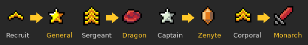

# Custom Clan Rank Icons
Pick your own icon for every rank in your clan. Only you see the change.

- [Installation](#installation)
- [Rank icon panel](#rank-icon-panel)
- [Pick an in-game icon](#pick-an-in-game-icon)
- [Presets](#presets)
- [Bulk apply](#bulk-apply)
- [Player icons](#player-icons)
- [Share codes](#share-codes)
- [Where your icons show up](#where-your-icons-show-up)
- [Settings](#settings)
- [How it works](#how-it-works)
- [FAQ](#faq)
- [Support and suggestions](#support-and-suggestions)
- [Changelog](#changelog)

## Installation
1. Open RuneLite and click the **Configuration** (wrench) icon in the sidebar.
2. Click **Plugin Hub** at the bottom of the panel.
3. Search for **Custom Clan Rank Icons** and press **Install**.

## Rank icon panel
Open the panel from the gold star button in the RuneLite sidebar. It lists every rank in your clan:

- The **left icon** is the game's icon for that rank.
- The **right icon** is your replacement (a dash means it hasn't been changed).
- Next to them is the rank's title and rank number.

If your clan adds or renames ranks while you're online, press **Refresh ranks** to update the list.

Each clan keeps its own icons, so switching accounts or clans won't mix them up.

## Pick an in-game icon
Press **Change** on any rank to open a grid of every clan rank icon in the game.
Type in the search box to filter by name, hover an icon to see its name, and click it to use it for that rank.

Press **No icon** in the same window to hide that rank's icon completely.

Icons like Dragon, Zenyte, Monarch, the god ranks and the skill ranks are all available, whether or not your clan uses them.

## Presets
Press **Presets** to give all your clan's ranks a themed set in one click, from your lowest rank to your highest:

| Preset | Icons |
| --- | --- |
| Military | Recruit, Corporal, Sergeant, Lieutenant, Captain, General |
| Metals | Bronze, Iron, Steel, Mithril, Adamant, Rune, Dragon |
| Gems | Opal, Jade, Red Topaz, Sapphire, Emerald, Ruby, Diamond, Dragonstone, Onyx, Zenyte |
| Royal court | Pawn, Page, Squire, Knight, Noble, Monarch |
| Gods | Serenist, Xerician, Tirannian, Armadylean, Bandosian, Guthixian, Zarosian, Zamorakian, Saradominist |

If your clan has more ranks than the preset has icons, neighbouring ranks share an icon. Guests aren't changed.

## Bulk apply
Press **Bulk apply**, choose a range of ranks (for example everything from Recruit up to Sergeant), then pick one icon
to use for all of them.

## Player icons
Press **Add player icon** at the bottom of the panel, type a player's name, and pick an icon. That icon shows next to
their name in chat (clan, public, friends chat and private messages), even if they aren't in your clan. Press
**Remove** to take it away again.

## Share codes
Press **Copy code** to copy your clan's icon setup as a short code, for example `CRI1:126=s1234,100=h`.
Clanmates with the plugin can press **Paste code** to get the same icons.

## Where your icons show up
Your icons replace the originals everywhere the game draws them, on your screen only:

- Clan chat messages
- The clan member list and the clan settings screens
- Clan join/leave messages from RuneLite's Chat Channel plugin (optional)
- Rank icons in right-click menus from RuneLite's Player Indicators plugin (optional)
- Public chat, next to your clanmates' names (optional)

Press **Reset** on a rank to go back to its normal icon, or turn the plugin off to restore every icon at once.

## Settings
| Setting | What it does |
| --- | --- |
| Show sidebar button | Hide the Clan Rank Icons button once you've set things up. Your icons stay applied. |
| Replace RuneLite's rank icons | Also swap the rank icons RuneLite adds itself, in join/leave messages, public chat and right-click menus. |
| Show icons in public chat | Show clan rank icons next to your clanmates' names in public chat. |

## How it works
The game picks a rank's icon from its **title** (for example "Sergeant" or "Captain"), and every title has its own sprite.
When you choose an icon for a rank, the plugin finds which title that rank uses and tells RuneLite to draw your chosen
icon in place of the original sprite. Nothing is sent to the game server or to anyone else.

A few things to know:

- Icons follow titles, so two ranks in your clan that share a title also share a replacement. The more senior rank's choice wins.
- The game uses the same artwork for a title in every clan, so a replaced icon also changes in your guest clan if it uses the same title.
- If your clan changes a rank's title, your icon follows the rank to its new title automatically.

## FAQ
**Can other players see my icons?**\
No. The change is drawn by your RuneLite client only. Everyone else still sees the normal icons.

**I changed one rank, but another rank changed too. Why?**\
The game picks icons by rank title, not rank number. If two ranks in your clan use the same title, they share an icon,
so they also share your replacement. The more senior rank's choice is used.

**Why did an icon in my guest clan change as well?**\
A title uses the same artwork in every clan. If your guest clan uses a title you've replaced, you'll see your icon there too.

**My clan isn't showing in the panel.**\
Make sure you're logged in and in your clan, then press **Refresh ranks**.

**Why doesn't a player icon replace their rank icon in clan chat?**\
The game draws clan rank icons itself, and those follow the rank. A player icon is added next to their name instead.

**How do I go back to the normal icons?**\
Press **Reset** on a rank, or turn the plugin off to restore every icon at once.

## Support and suggestions
Found a bug or have an idea? [Open an issue](https://github.com/JayEngland/Custom-clan-ranks-icons/issues) with a short
description, and a screenshot if it helps.

## Changelog
**1.1**
- Icons are saved separately for each clan.
- Presets: themed icon sets applied in one click.
- Bulk apply: one icon for a range of ranks.
- Player icons: give individual players their own icon in chat.
- Search box and a "No icon" option in the icon picker.
- Share codes to copy and paste icon setups between clanmates.
- Optional clan rank icons in public chat.
- Custom icons now also replace RuneLite's rank icons in Player Indicators' right-click menus.
- Removed image uploads. Icons picked from uploads go back to normal.

**1.0**
- First release: pick an in-game icon or upload your own image for each clan rank.
- Optional replacement of clan join/leave message icons.
- Setting to show or hide the sidebar button.
